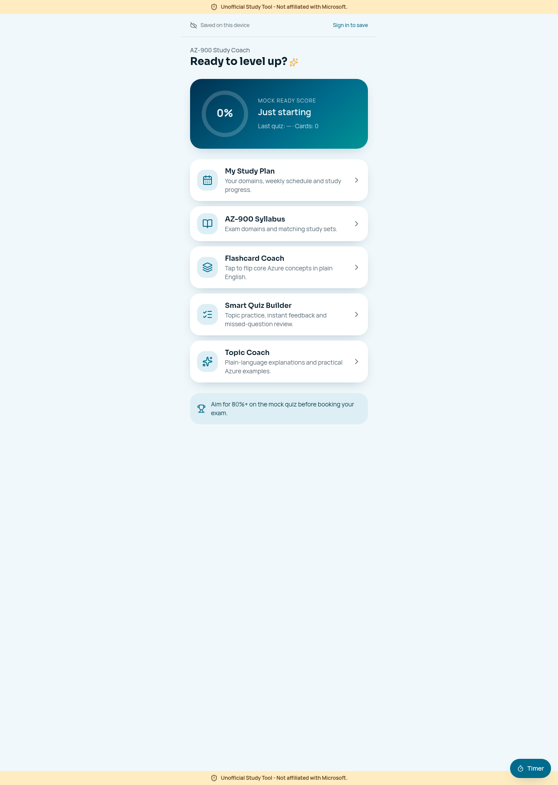

# Unofficial AZ-900 Smart Quiz & Flashcard Coach

**Understand Azure concepts. Practise with feedback. Build a study habit.**

> Unofficial Study Tool - Not affiliated with Microsoft.

Created by **Charity Lovi** for AZ-900 learners. Built with Lovable, React, TypeScript and TanStack Start.

## Start here

- **[Open the live demo](https://azure-ready-rally.lovable.app)**
- **[Three-minute demo guide](docs/DEMO.md)**
- **[Judging criteria and evidence](docs/HACKATHON.md)**
- **[Prompt engineering and development process](docs/PROMPT_ENGINEERING.md)**
- **[Setup and architecture](docs/SETUP.md)**
- **[Learning content and official references](docs/CONTENT.md)**
- **[Verification and limitations](docs/VERIFICATION.md)**



## The problem

Azure fundamentals introduce many similar-sounding services and responsibilities. Reading a definition once does not necessarily help a beginner distinguish IaaS from PaaS, remember who patches a VM, or recognise which storage option fits a scenario. Learners also need manageable study sessions and a way to return to what they missed.

This prototype combines short explanations, active recall, instant answer feedback and a study schedule in one mobile-friendly experience. It supports preparation alongside Microsoft Learn, rather than replacing the official syllabus.

**Primary users:** first-time cloud learners, students and professionals preparing for AZ-900, including people studying mainly on a phone. Guest study tools do not require prior Azure deployment experience or an account.

## What is built

| Experience | What the learner can do |
|---|---|
| Dashboard | Open study modes and see a practice-based readiness indicator. |
| Flashcard Coach | Review 20 cards and reveal friendly explanations. |
| Smart Quiz Builder | Practise from 15 original questions, filter topics/domains, choose session length and get immediate explanations. |
| Missed-question retry | Retry only the questions missed in the current quiz session. |
| Readiness Tracker | See a final quiz score and answer review; this is not an exam-pass prediction. |
| Topic Coach | Select one of 20 topics for a curated explanation and practical Azure example. |
| Syllabus | Browse all three exam domains and open corresponding available flashcards and questions. |
| Study plan | Choose domains, dates, weekdays, time and duration; track unique cards reviewed and questions answered. |
| Cloud save | Optionally sign in to sync a private plan, card activity and quiz history; explicitly import guest progress. |
| Study timer | Start/stop a timer, see daily/all-time study time, and choose 30/45/60-minute reminders with five-minute breaks. |

**Important:** the Topic Coach uses local study notes, not live AI generation. Paid AI requests are disabled. Timer data stays on the device and notifications depend on browser permission/support. Two-device cloud sync is implemented but still awaiting live signed-in end-to-end verification.

## Why these choices matter

- **Feedback at the point of confusion:** answers include the concept behind the score.
- **Honest coverage:** repeat visits do not inflate unique-item study-plan progress.
- **Deliberate retry:** missed questions remain scoped to the current session.
- **Guest-first study:** core learning tools can be explored without an account.
- **Privacy-aware sync:** guest data is not silently attached to a signed-in account.
- **Cost-conscious coaching:** local explanations avoid live AI request charges.
- **Phone-friendly practice:** short activities are useful when a laptop is unavailable.

## Quick start

Install a current Node.js LTS release and Bun:

```sh
git clone https://github.com/charity-gis/Azure_study_app.git
cd Azure_study_app
bun install
cp .env.example .env
# Configure your own backend; see docs/SETUP.md.
bun run dev
```

Use the local address printed by Vite. A clone does not provision the hosted backend automatically. Never commit `.env`, private keys, tokens or learner data.

```sh
bun run test        # automated behavior tests
bun run lint        # lint checks
bun run build       # production build for your hosting environment
```

**Verified on 24 October 2026:** 27 tests passed across 6 test files. This is not proof of every browser, authentication or hosted deployment scenario. See [verification notes](docs/VERIFICATION.md).

## Project map

```text
src/routes/                 Dashboard and study pages (TanStack file routes)
src/components/             Cloud save, timer, headers, disclaimer and UI
src/lib/content.ts          Original flashcards and practice questions
src/lib/coach-topics.ts     Local topic explanations and Azure examples
src/lib/practice.ts         Question selection and missed-answer rules
src/lib/syllabus.ts         Exam domain mappings and search validation
src/lib/study-plan.ts       Schedule validation and unique-item coverage
src/lib/cloud-study.ts      Snapshot validation and deterministic merge rules
src/lib/device-storage.ts   Guest/account-scoped browser storage
src/lib/study-timer.ts      Study/break timing helpers
src/test/                   Automated behavior tests
drizzle/migrations/         Schema, ownership policies and sync function
docs/                       Hackathon evidence, setup, demo and sources
```

## Scope and next steps

The app has **20 flashcards, 15 questions, 20 coach topics and 3 syllabus domains**. Listing every domain does not mean the question bank covers every exam objective. No official Microsoft exam questions or logos are used.

Next priorities: full objective-level content coverage, signed-in two-device testing, timer edge-case tests, accessibility/user testing and pilot feedback. Other certifications could reuse the study structure with separately reviewed content; those extensions are not built yet.

## Contributing and responsible use

See [CONTRIBUTING.md](CONTRIBUTING.md) and [SECURITY.md](SECURITY.md). Learning outcomes, adoption and pass rates have not been measured. No open-source licence has been selected; ask the author before redistribution beyond applicable platform terms.

> Unofficial Study Tool - Not affiliated with Microsoft. Azure and Microsoft are trademarks of their respective owners. Check the current official study guide and service documentation.
