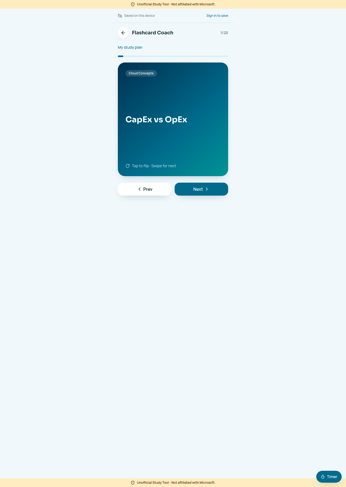
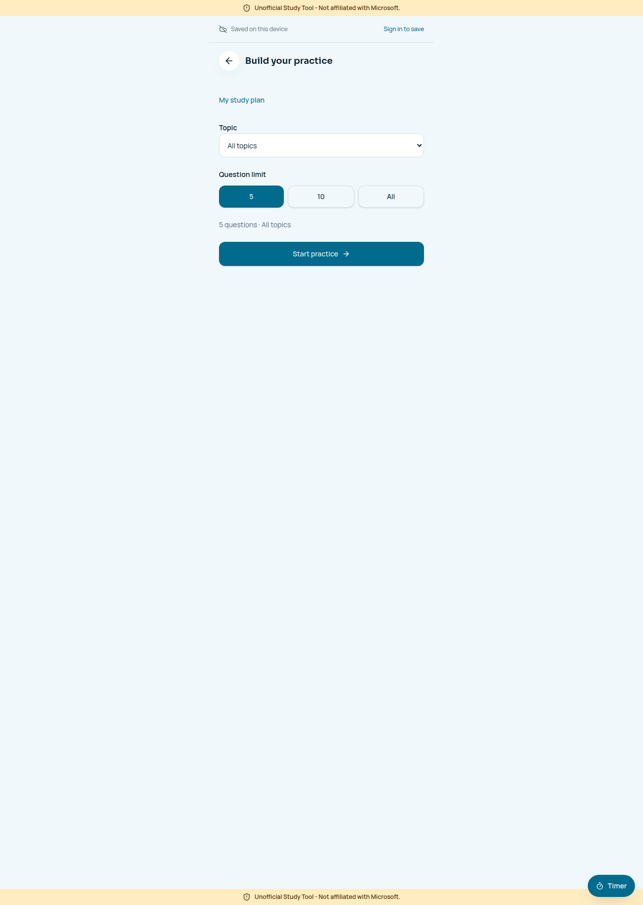
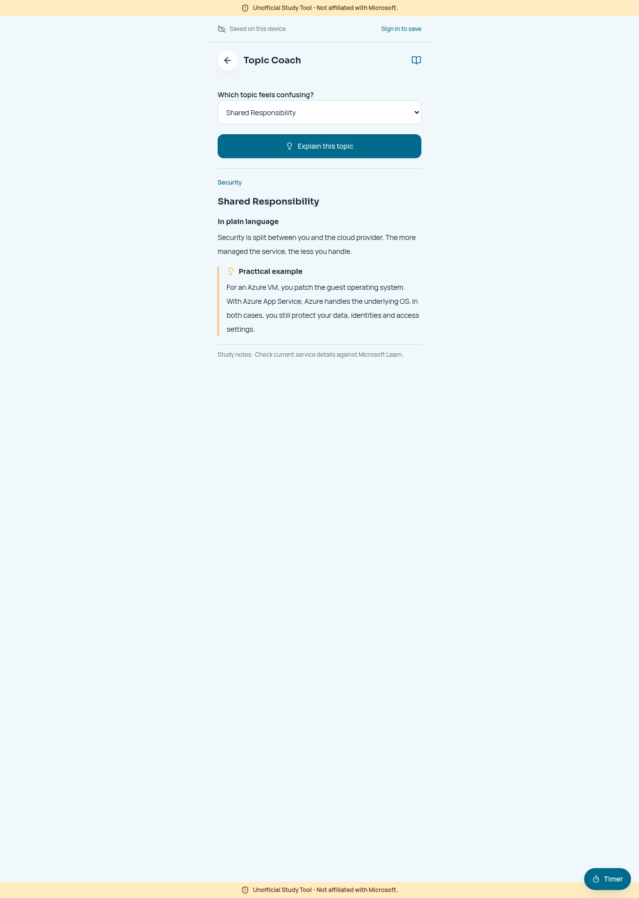

# Three-minute demo guide

Open https://azure-ready-rally.lovable.app and use guest study first. Have this repository and the screenshots ready as a fallback. The published demo may lag the latest source until a publish is performed; check it before presenting.

| Time | Action | What to say |
|---|---|---|
| 0:00–0:20 | Open dashboard; point out the unofficial notice. | “This is a study companion for beginners, not an official Microsoft product.” |
| 0:20–0:50 | Open Flashcards and reveal a concept. | “A short explanation makes the concept easier to recall.” |
| 0:50–1:30 | Start a quiz, answer and show feedback. | “The explanation matters more than the score: it teaches why the answer fits.” |
| 1:30–1:55 | Finish a short session; show answer review and missed-question retry if available. | “Learners can revisit what they missed instead of rereading everything.” |
| 1:55–2:20 | Open Topic Coach and explain Shared Responsibility. | “These are curated local notes and examples; no paid AI requests are made.” |
| 2:20–2:45 | Show syllabus and a study plan's domain selection and progress. | “Study goals connect to the available practice sets, and unique progress avoids counting repeat visits.” |
| 2:45–3:00 | Open timer, then return to repository evidence. | “The prototype combines practice and study habits. Here are the tests, limits and next steps.” |

Do not wait 30 minutes for a reminder during a short presentation. Do not claim browser notifications always work or that a readiness score predicts an exam pass. Optional cloud save should only be demonstrated after verifying sign-in and two-device behavior.

## Screenshots from the running app

### Dashboard

### Flashcards

### Quiz builder

### Local Topic Coach

These are real page captures, not generated mockups. They show the current prototype, not measured learner outcomes.
