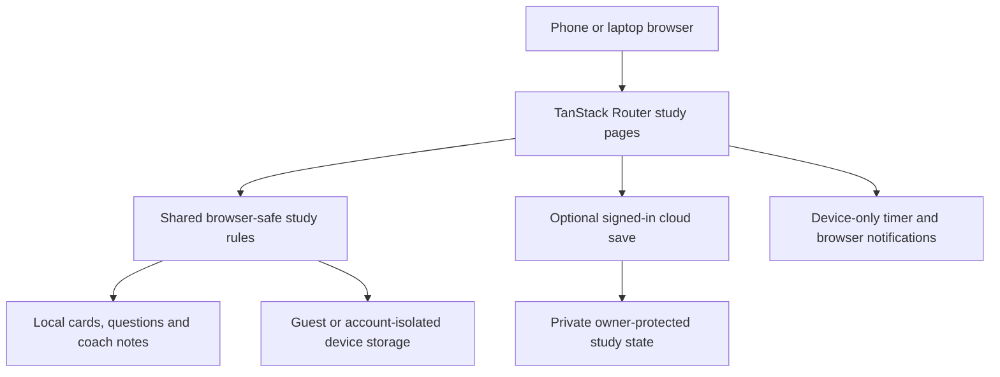

# Development setup and architecture

## Requirements

- A current Node.js LTS release and Bun.
- Your own configured backend for authentication and private study sync.
- A supported hosting environment for the TanStack Start server output; Vite static hosting alone is not a complete deployment.

## Local development

```sh
bun install
cp .env.example .env
# Populate public backend configuration for your own instance.
bun run dev
bun run test
```

The generated browser client requires valid backend configuration even when exploring guest pages. Environment variable names are shown below; this repository does not include the author's `.env`, credentials or learner data.

| Variable | Use |
|---|---|
| VITE_SUPABASE_URL | Browser backend endpoint for your own instance. |
| VITE_SUPABASE_PUBLISHABLE_KEY | Browser-safe publishable key; never substitute a private key. |
| SUPABASE_URL | Server runtime endpoint if required by your hosting setup. |
| SUPABASE_PUBLISHABLE_KEY | Server publishable configuration if required. |
| LOVABLE_DB_MIGRATION_URL | Private migration connection supplied by the managed environment; never expose in browser code. |

The SUPABASE names above are literal software configuration identifiers, not instructions to retrieve private managed credentials. Lovable Cloud users should configure backend/auth through Lovable; managed database passwords and service-role keys are not available to export.

## Backend provisioning

Cloning the source does not clone accounts, provider configuration or study data. In Lovable, keep the existing managed backend when working on the original project. A separate deployment must configure its own backend, apply the SQL migrations in order, and set up the authentication providers it offers.

Migrations:

1. `0000_ai_coach_access_state.sql`: historical server-only AI access-block table; local coaching does not use runtime AI.
2. `0001_private_study_cloud_sync.sql`: private study state, owner-scoped row security and an atomic sync function.
3. `0002_restrict_study_cloud_grants.sql`: explicitly removes guest table access.

Do not treat a successful migration as an authentication test. Verify that signed-in users see only their own data, guests cannot access private rows, and two devices converge on the same study state. Configure Google and Lovable sign-in and allowed redirect URLs appropriate to your own deployment before advertising them as working.

## Architecture



The study modules are shared with tests, reducing disagreement between quiz/plan behavior and test expectations. Cloud snapshots combine unique activity and quiz run IDs; plan edits resolve by the latest timestamp. Guest import is explicit. The timer uses separate device storage and is not part of cloud snapshots.

## Build and hosting

```sh
bun run build
```

The Vite configuration uses the Lovable TanStack config package with a Cloudflare-targeted server build. Provide the runtime configuration required by your chosen host. The repository contains a managed error-reporting wrapper; porting to unrelated hosting requires reviewing these platform integrations. No claim is made that copying the source to a static host will reproduce the managed deployment.

## GitHub export versus ongoing sync

This repository was populated through the GitHub API. That is a source snapshot, not an automatic two-way Lovable Git sync connection. Lovable Git sync creates a new repository and cannot attach an existing repository. Keep future export updates deliberate and avoid overwriting work made independently on GitHub.
